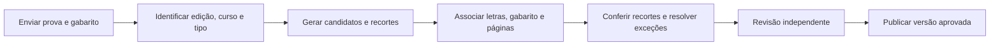

# Questões como imagens e importação de prova + gabarito

Pedido de Gabriel em 28/10/2026. Documento compartilhado entre Claude Code e Codex. **Estado atualizado: recortes versionados, visualizador e publicação assistida entregues pelo Claude na main `42a45d6`; upload, editor acompanhado e variantes por largura ainda são proposta.** Tarefas e donos ficam em [WORKBOARD.md](WORKBOARD.md).

## Coordenação com o trabalho do Claude

Durante este estudo foi localizado o [PR #16 da trilha Claude](https://github.com/bielrodrigues2406/enade-cs-platform/pull/16), posteriormente integrado na main `42a45d6`: ele registra a ADR-010, a recuperação Unicode de 2014/2017 e um caminho de conferência por agente independente de quem extraiu. A entrega final inclui recortes, exibição por imagem e publicação ASSISTED (ADR-011), além da curadoria existente. O upload e o editor acompanhados deste documento continuam propostos. A conferência de conteúdo e os achados posteriores estão em [CNT-T1/CNT-V1](reviews/derived-text-quality.md).

O handoff inicial do PR #16 propôs Claude em CNT-C1 (recortes) e CT-1b (exibição), e Codex em CNT-T1, CNT-V1 e PUB-A1. A decisão posterior D8 deixou imagens, publicação e catálogo com Claude; Codex segue na conferência e nos achados de integridade. IMG-I1/IMG-U1 devem reutilizar esses trabalhos para o upload e o editor, sem criar outro renderizador/visualizador. Conferência por agente continua identificada como `ASSISTED`; nunca será registrada como revisão humana.

Conciliações de contrato: a lista de alternativas depende do caderno (A–D ou A–E); o PNG previsto em CNT-C1 pode ser um derivado técnico e o WebP sem perda uma variante de entrega, com hashes próprios e vínculo ao mesmo original. Isso ainda deve ser combinado antes de implementar. A publicação assistida também precisa contemplar a conferência das **fontes**: hoje documentos VERIFIED e versões editoriais registram revisores vinculados a contas. Não basta mudar a última transição de publicação nem criar contas fictícias para agentes.

## Direção recomendada

Usar a captura fiel da questão no PDF como apresentação visual principal. O estudante vê o enunciado, as figuras e as alternativas impressas na imagem, seguido de controles de resposta A–E, ou A–D conforme o caderno. Não precisa reconstruir tipografia, código, fórmulas ou diagramas em HTML para que apareçam corretamente.

Os controles usam IDs estáveis, associados à letra impressa e ao gabarito conferido. O recorte não contém destaque da resposta correta. A letra correta e a explicação continuam separadas da imagem e obedecem às regras de revelação do estudo e do futuro simulado. Não há texto fictício de alternativa apenas para satisfazer o contrato atual.

Não embaralhar alternativas já impressas dentro da imagem. A associação letra impressa → ID → gabarito precisa permanecer coerente, inclusive quando a ordem das questões de uma sessão mudar.

Uma questão pode ter **vários recortes ordenados**, em colunas ou páginas distintas. Um texto comum a duas questões precisa acompanhar ambas; não basta cortar entre dois números encontrados. Imagens preservam também eventuais erros do original, que exigem nota editorial identificada.

Texto auxiliar pode apoiar busca, leitura assistiva e seleção; OCR não é pré-requisito para gerar as capturas nem a fonte visual exibida. A imagem isolada não atende leitores de tela: o lote publicado precisa de representação acessível revisada, incluindo figuras quando necessário. `alt="Questão 12"` não substitui o conteúdo. Publicar um primeiro lote acessível é diferente de esperar a transcrição integral de todo o acervo.

## O que será apresentado ao estudante

1. Edição, curso/modalidade, caderno e número original, com situação da coleção explícita.
2. Captura(s) nítida(s), na ordem de leitura; ajuste à largura, ampliar/reduzir e abrir detalhe. A tela indica continuações e não exige arrastar para alcançar os controles.
3. Seleção A–E/A–D e confirmação por teclado ou toque, com estado de salvamento e recuperação de falha. Alternativas visuais continuam legíveis dentro dos recortes; não são substituídas por nomes de obras ou descrição que revele a resposta.
4. Após responder no estudo, feedback, comentário editorial e procedência. No simulado, gabarito e explicação só aparecem após a finalização. Quando aplicado o caminho da ADR-010, rótulo visível: “Transcrição automatizada do PDF oficial, conferida por agentes; sem revisão humana”.
5. Acesso à representação textual/assistiva equivalente, sem afirmar que o OCR bruto foi conferido. Erro no carregamento da imagem oferece retry e não conta como tentativa respondida.

Carregar a questão atual, com pré-carregamento limitado da próxima. Não baixar centenas de imagens ao abrir o catálogo. Mostrar dimensões antes do download evita deslocar os controles; versões de imagem por largura/resolução evitam servir o maior arquivo a todo celular. A nitidez das letras pequenas, negações, índices e ponteiros precisa de conferência visual.

## Peso medido e recomendação

Foram medidos **42 candidatos, em 49 recortes**, seis por edição de 2005/2008/2011/2014/2017/2021/PND 2025. A seleção intencional inclui texto, código, fórmulas, fotos e múltiplos fragmentos; não é amostra aleatória. Os limites não foram integralmente revisados: o ensaio mede arquivos, não aprova capturas ou um importador. Nenhum dos 605 itens foi convertido em versão editorial por este estudo.

Valores por questão, somando todos os fragmentos. KB/MB/GB decimais; projeções pela média da amostra, para uma variante, sem cache ou overhead de transferência.

| Formato | Média por questão | Mediana | P95 | 40 questões, sem cache | Projeção para 605 | Projeção para 10 mil |
| --- | ---: | ---: | ---: | ---: | ---: | ---: |
| PNG, 200 DPI | 386,0 KB | 289,9 KB | 1.135,6 KB | 15,44 MB | 233,53 MB | 3,86 GB |
| WebP sem perda, 150 DPI | 101,3 KB | 44,6 KB | 391,1 KB | 4,05 MB | 61,31 MB | 1,01 GB |
| WebP sem perda, 200 DPI | **148,1 KB** | **60,5 KB** | 569,3 KB | **5,93 MB** | **89,62 MB** | **1,48 GB** |
| WebP qualidade 82, 200 DPI | 131,5 KB | 125,6 KB | 256,6 KB | 5,26 MB | 79,57 MB | 1,32 GB |

Recomendação: **WebP sem perda a 200 DPI como ponto de partida do piloto**, ajustando resolução após testar celular/zoom. Foi menor que a versão com perda em 32 dos 42 itens; fotografias puxam sua média para cima. Nos três exemplos de código, circuito/fórmulas e fotografias, em duas resoluções, a comparação PNG → WebP sem perda teve diferença de pixels zero. Isso comprova a codificação desses exemplos, não a correção dos limites nem a fidelidade integral da renderização do PDF.

Armazenamento nessa escala é viável. Para os 605 itens, cerca de **90 MB é uma projeção**, não o tamanho de capturas finais já aprovadas. Originais, outra resolução, histórico e backups são adicionais; preços dependem do provedor. Mil sessões baixando 40 questões novas a 200 DPI, sem cache, projetam aproximadamente 5,93 GB de transferência só das imagens.

Se o contrato preservar PNG a 200 DPI além do WebP a 200 DPI, a soma projetada das duas variantes é cerca de **323 MB para 605 itens**, antes de originais, histórico e backups. O número de 90 MB representa só uma variante de entrega.

O arquivo comprimido não é a memória no navegador: a média de pixels dos fragmentos de uma questão a 200 DPI equivale a **8,53 MB em RGBA**, P95 15,62 MB e máximo 29,92 MB. Quarenta questões decodificadas juntas corresponderiam a cerca de 341 MB só em pixels, além de buffers e interface. Esses números são cálculos por dimensão, não medição de heap real. Carregamento sob demanda e liberação de imagens antigas são requisitos.

Poppler 26.05.0 e ImageMagick 7.1.1-43 renderizaram/codificaram as 294 variantes sequencialmente em 167,4 s neste ambiente; não é SLA de importação. O [recibo da medição](reviews/question-image-benchmark.json) guarda fontes/SHA-256, coordenadas, dimensões, parâmetros e tamanhos. O script, as imagens e o recibo completo ficam em `.local/planning-image-questions/benchmark/`. Somente três exemplos a 200 DPI foram inspecionados visualmente; não houve teste de leitura mobile dessas capturas, leitor de tela ou medição de tráfego real.

## Fluxo de importação proposto

| Etapa | Trabalho automático | Conferência e exceções |
| --- | --- | --- |
| Entrada | Receber prova e gabarito, calcular SHA-256, arquivar os originais | MVP para curadoria autorizada; enviar um PDF não o torna oficial. Importação pessoal por alunos é uma extensão de produto separada |
| Identificação | Sugerir edição, família, curso/modalidade, tipo e número de alternativas | Confirmar vínculo; PND tipo 4 não usa chave do tipo 1. Mapa de prova e padrão de resposta não são gabaritos objetivos |
| Localização | Detectar cabeçalhos, colunas, continuações e contextos compartilhados; OCR de localização quando preciso | Fronteiras ambíguas ficam pendentes. Coordenadas de texto não garantem que figuras inteiras foram incluídas |
| Captura | Renderizar o PDF e gerar sequência de recortes, mantendo origem e coordenadas | Ajustar margens, incluir/remover/reordenar regiões e comparar com o original lado a lado |
| Gabarito | Ler número, letra, página, anulação e indicação de versão/definitivo | Chaves contraditórias, ausentes, preliminares ou de outro caderno bloqueiam a associação aprovada; não preencher por posição presumida |
| Entrada privada | Criar/retomar lote idempotente e classificar exceções | Reenvio dos mesmos bytes não duplica questões nem sobrescreve ajustes do curador |
| Publicação | Aplicar o fluxo editorial versionado e o caminho de revisão habilitado | Sucesso do processamento não aprova fontes, recortes, acessibilidade ou conteúdo. A proposta do PR #16 usa outro agente, com evento ASSISTED; não simular conta/aprovação humana |

Discursivas preservam seus recortes e padrão correspondente em fila própria. Anuladas permanecem identificadas e não ganham uma letra substituta. A interface deve distinguir quantidade esperada, localizada, conferida e publicada; caderno parcial não recebe rótulo de prova completa.

## Dados e infraestrutura necessários

- Reutilizar `SourceDocument`, fila privada e versões editoriais. Vincular cada ativo à versão da questão e ao hash do PDF; guardar página, retângulo no sistema de coordenadas do PDF, ordem, dimensões, formato, DPI e versão da ferramenta de renderização. Capturas são derivadas, não substitutos dos originais.
- Manter identidade lógica e equivalências entre cadernos separadas de identidade dos arquivos. Deduplicação por hash elimina ativos idênticos; não comprova equivalência pedagógica de questões ou variantes.
- Armazenar bytes em volume persistente ou serviço de objetos; guardar referências/metadados no PostgreSQL. Evitar base64 dentro das respostas JSON e PDFs/imagens no Git. Backup e restauração abrangem banco, originais e ativos aprovados.
- Ativos privados de importação continuam autorizados por curadoria. Somente capturas de versões publicadas podem ter entrega pública/cache correspondente; URL, nome do arquivo, EXIF, texto assistivo e metadados públicos não incluem a chave correta. Corrigir captura/gabarito cria versão nova, preservando tentativas antigas.
- Upload exige limite de bytes/páginas/pixels, validação real de PDF, autenticação, controle de origem, limites de frequência e armazenamento. O middleware atual só aceita JSON; habilitar multipart precisa de contrato próprio, sem liberar globalmente escritas arbitrárias.
- Renderizar fora da requisição HTTP, em processo/worker com tempo e memória limitados. Acompanhar estado e progresso por lote/página; permitir retry, cancelamento e retomada sem apagar o que foi conferido. Uma fila persistida no PostgreSQL pode bastar inicialmente; Redis/BullMQ só se a operação justificar.
- O catálogo atual valida os relatórios contra documentos fixados em JSON. O uploader futuro precisa de cadastro autorizado de novas fontes e vínculo verificável com o registro; não deve contornar essa validação aceitando metadados do arquivo como verdade.

## Piloto antes da ampliação

Começar com 20 questões diversas das fontes disponíveis: texto, código, fórmula com negação/índice, fotografia, circuito/árvore, alternativas em grade, duas colunas, continuação de página e texto compartilhado. Incluir quatro alternativas, item anulado e discursiva como casos de exceção, sem publicá-los através do fluxo objetivo comum.

Medir acerto dos limites contra conferência manual, correspondência de número/alternativa/gabarito, nitidez, bytes por questão, tempo de geração, consumo de memória e esforço para corrigir cada item. Não presumir precisão de 100% por a imagem parecer fiel. Para desempenho de interface, medir uma questão em rede limitada e a navegação consecutiva; tamanho comprimido não é a memória usada após decodificar.

Critérios para ampliar: nenhum item do piloto com contexto/alternativa cortados após revisão; numeração e tipo preservados; associação de gabarito conferida; correção versionada sem alterar histórico; teclado, zoom e conteúdo assistivo verificados. Os números de desempenho são metas a definir a partir do piloto, não resultados de testes com estudantes.

## Execução entre as trilhas

| Trabalho | Trilha proposta | Entrega |
| --- | --- | --- |
| CT-1 e integração com CT-1b/CNT-C1 do PR #16 | Codex + Claude, contratos por domínio | Modelo/versionamento e captura/exibição entregues pelo Claude na migration 008; 010 não utilizada. Codex confere os itens e os achados de integridade |
| IMG-I1 | Codex | Entrada de prova/gabarito e processamento acompanhado, reutilizando extrator/recortes e candidatos idempotentes; nova migration somente após conferir as reservas do quadro |
| IMG-U1 | Claude, a combinar no quadro | Upload, identificação e comparação/ajuste de recortes, integrados à exibição CT-1b; começar pelo contrato acordado com Codex |
| CAT-1 | Codex, API e interface (D12, pedido de Gabriel em 29/10) | Catálogo paginado com total, área canônica/assunto/ano e seleção por endereço. Curso/modalidade permanecem metadados da origem; filtros específicos por curso/caderno poderão ser avaliados quando houver acervo publicado diverso |
| Lote piloto e publicação | Extrator e revisor independente, com registro do caminho aplicado | Conferência de origem, captura, gabarito e acessibilidade; usar o caminho assistido das ADR-010/011 após conferir os bytes exatos. Não atribuir revisão humana a agentes |

Os agentes não iniciam a tarefa da outra trilha nem editam migrations aplicadas. A entrega de imagens/publicação veio do PR #16; o fluxo de upload/editor continua pendente. Não se atribui aprovação editorial a simulações de alunos/professores. A avaliação do produto e as pendências estão em [análise por perspectivas](reviews/2026-10-28-product-perspectives.md).
